MyStore 🛍️

A responsive e-commerce web application built with React.

🚀 Live Demo

https://my-store-ten-jade.vercel.app/

✨ Features

* Browse products.
* View product details.
* Add products to the shopping cart.
* Navigate between pages using React Router.
* Toggle between Dark Mode and Light Mode.
* Responsive design for different screen sizes.

🛠️ Technologies Used

* React
* JavaScript
* React Router
* CSS
* Vite
* Vercel
* Git and GitHub

📄 Pages

* Home
* Products
* Product Details
* Cart
* About
* Not Found

⚙️ Installation

1. Clone the repository:

git clone https://github.com/AhmedSaidDiv/MyStore.git

2. Open the project folder:

cd MyStore

3. Install dependencies:

npm install

4. Start the development server:

npm run dev

🏗️ Build

npm run build

## 📸 Screenshots

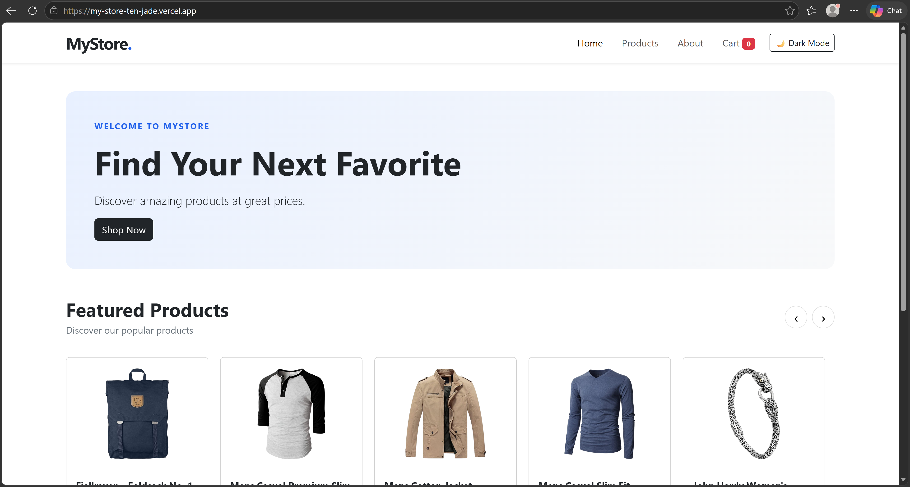
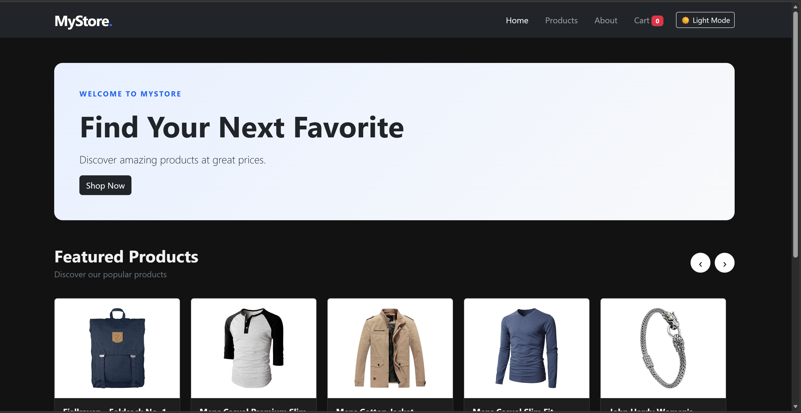
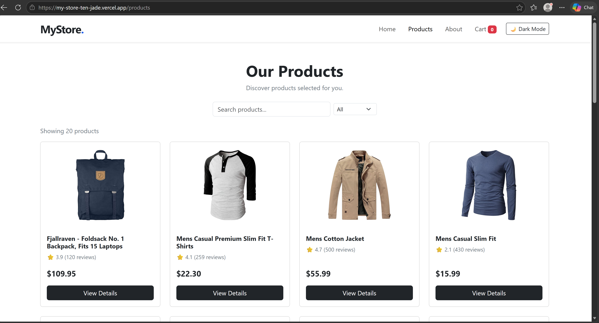
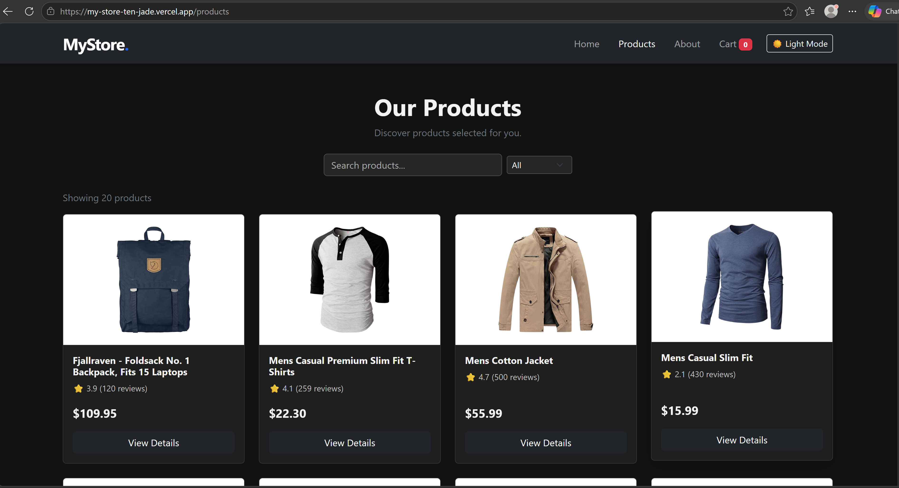
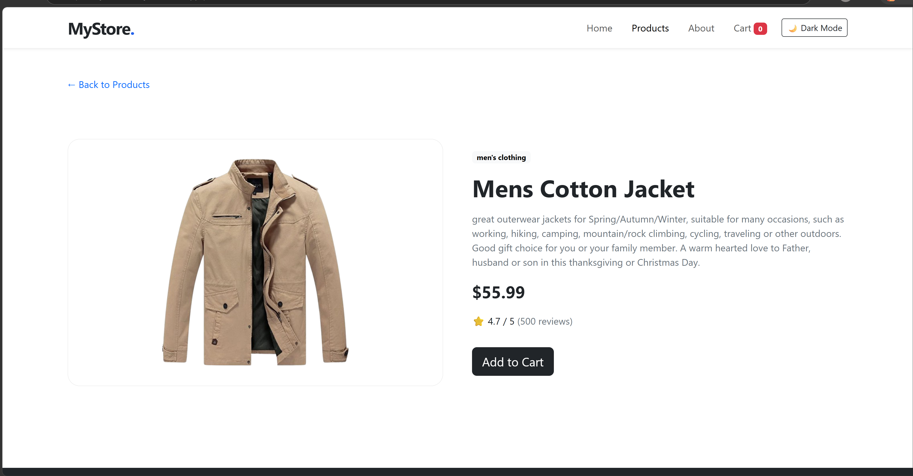
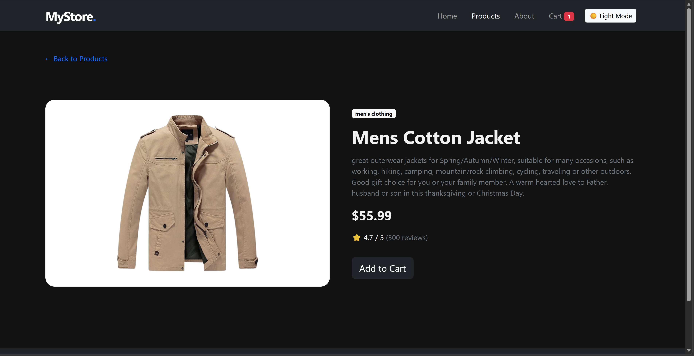
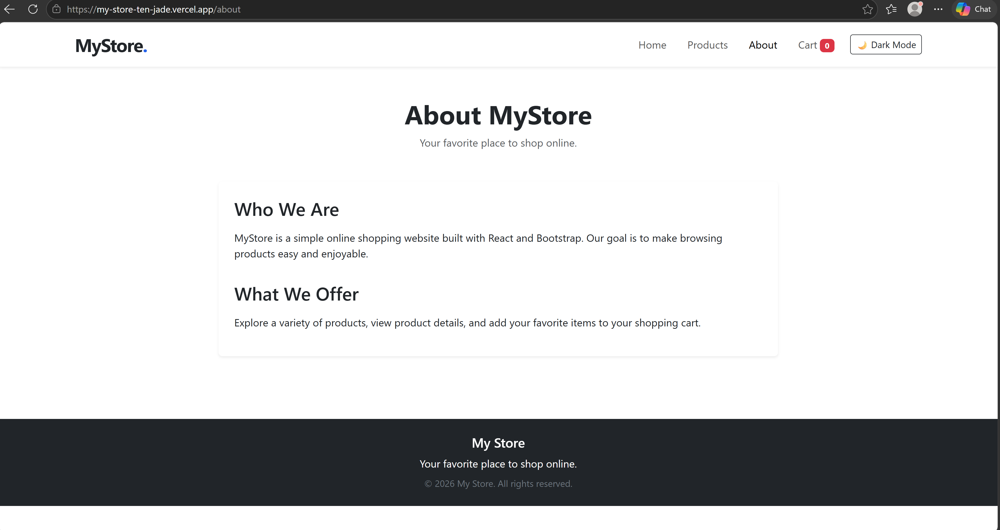
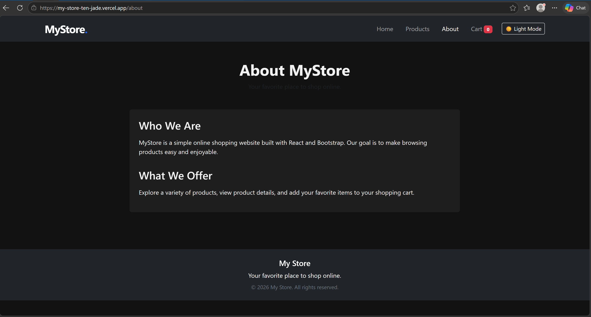
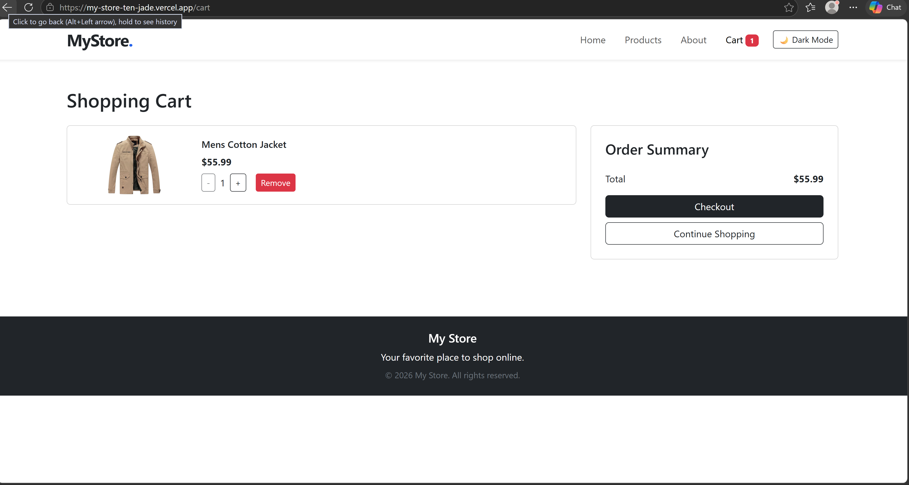
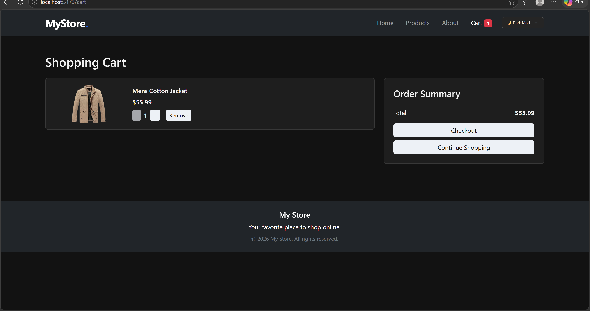
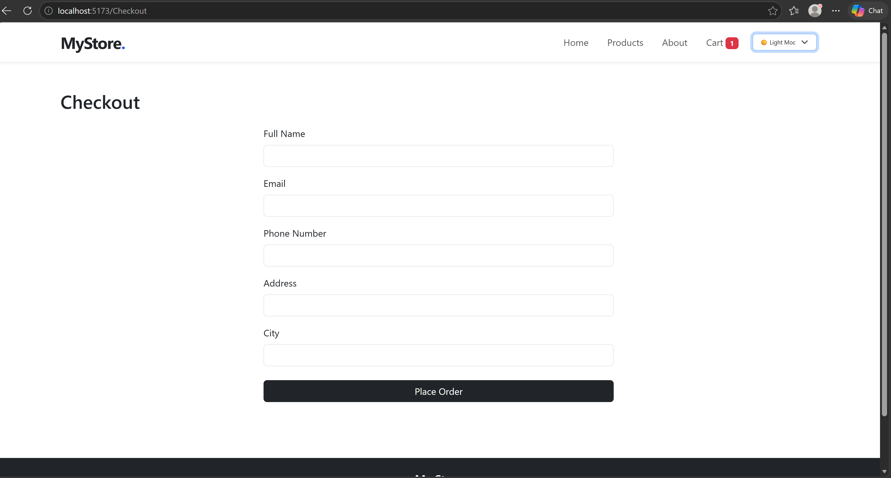
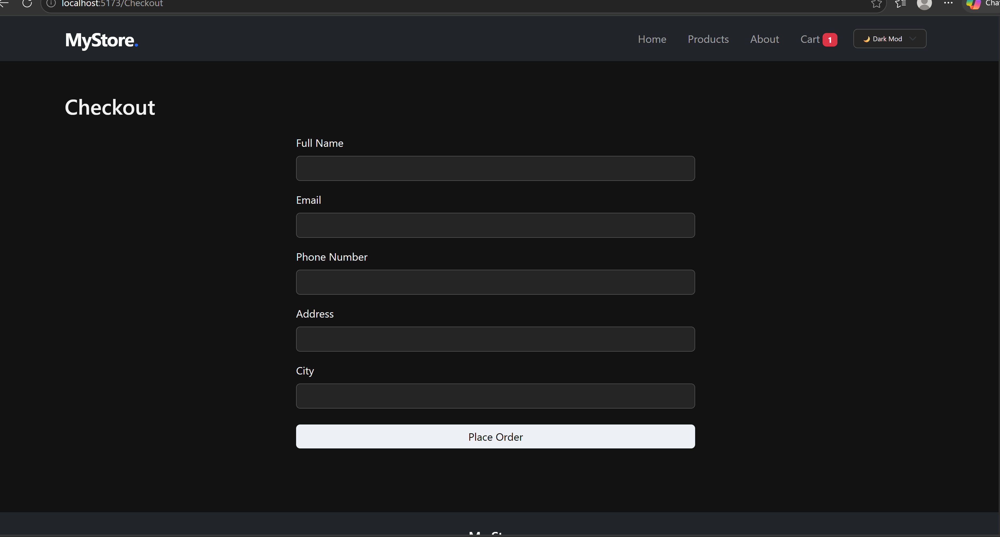

🎓 Project

Created as a React training graduation project.
